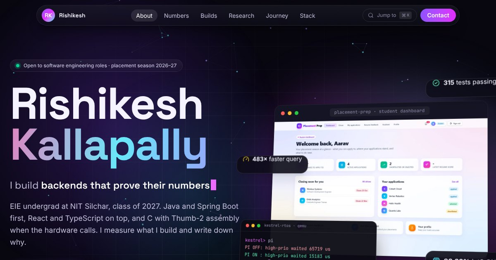

# Rishikesh Kallapally · Portfolio

A single-page portfolio that shows my projects in depth: what each one does, how it is built, and the measured evidence
behind it. Built with the same frontend stack I use in my projects: **React 19, TypeScript, Vite and Tailwind CSS 4**.

**Live site: [rishitheb0t.github.io/portfolio](https://rishitheb0t.github.io/portfolio/)**



## What's inside

| Section | What it shows |
|---|---|
| Hero | Name, typing role line, a 3D-tilting collage of real screenshots, a pointer-reactive particle field, headline numbers |
| 01 · whoami | A typing terminal, education (Department Rank 2), the SN Bose research internship, what I'm building now, how I work |
| 02 · Contributions | Tests, commits, lines of code and docs counted from the repos, with breakdowns by language and by repo |
| 03 · Featured builds | Deep dives into [placement-prep](https://github.com/RishitheB0T/placement-prep), [product-catalog-service](https://github.com/RishitheB0T/product-catalog-service) and [kestrel-rtos](https://github.com/RishitheB0T/kestrel-rtos) |
| 04 · Research & team work | EdgeMind (STM32F407 vibration fault detection) and the RL-PID controller (Team Viper) |
| 05 · Journey | An animated timeline from 2023 to placement season |
| 06 · Stack | Five layers of tools; pick a project to light up the tools it uses |
| 07 · Contact | Links, with empty ones hidden automatically |

Interactive pieces: an auto-playing screenshot gallery with a full-screen lightbox, an animated architecture diagram, a
replay of the AI assistant's tool calls, a log-scale query benchmark chart, an animated Redis cache-flow diagram, a
replay of the RTOS shell, the kernel's priority-inversion trace, and a command palette (press <kbd>Ctrl</kbd>+<kbd>K</kbd>
or <kbd>⌘</kbd>+<kbd>K</kbd>).

Every number on the page comes from the project repositories. Charts have hover and keyboard tooltips and a "view as
table" option, and every animation turns off when the visitor's system asks for reduced motion.

## Run it locally

You need Node.js 20 or newer.

```bash
npm install
npm run dev
```

Then open http://localhost:5173. To check the production build:

```bash
npm run build
npm run preview
```

## Edit the content

All text that describes me lives in `src/data/`:

- `src/data/profile.ts`: name, intro, links (add LinkedIn, email or a résumé link here; empty ones stay hidden), education,
  research, what I'm building now, and the totals.
- `src/data/stack.ts`: the tools in each layer and which projects use them.

Each project's deep dive is its own file in `src/sections/` (`PlacementPrep.tsx`, `ProductCatalog.tsx`, `Kestrel.tsx`,
`Research.tsx`), with its content written next to its layout.

## Project structure

```text
src/
├── App.tsx              page order and the animated background
├── index.css            design tokens (colors, fonts), effects and animations
├── data/                everything about me, as plain data
├── lib/hooks.ts         scroll-in-view, count-up, active section, reduced motion
├── components/          shared pieces: cards, terminal, charts, nav, lightbox
└── sections/            one file per section of the page
public/
├── images/              project screenshots (WebP) and diagrams
└── icons/               technology logos
```

## Deploying

The build is a static folder (`dist/`) with relative paths, so it works on any static host without changes:

- **GitHub Pages (what this repository uses):** every push to `main` runs the *Deploy to GitHub Pages* workflow, which
  builds the site and publishes it at `https://rishitheb0t.github.io/portfolio/`. It needs *Settings → Pages → Source:
  GitHub Actions*, and on a free GitHub plan the repository must be public.
- **Vercel or Netlify:** import the repository; the build command is `npm run build` and the output folder is `dist`.

## Credits

Technology logos from [Devicon](https://devicon.dev) (MIT). GitHub and LinkedIn marks from
[Simple Icons](https://simpleicons.org) (CC0). Interface icons from [Lucide](https://lucide.dev) (ISC). Fonts: Space
Grotesk, Inter and JetBrains Mono (SIL Open Font License) via Fontsource.
